# NeonGrid

> Una ciudad **cyberpunk en pixel art**, animada, para **KDE Plasma 6**: cada cartel de neón es un **dato real de tu equipo** (CPU, RAM, red, VPN, repos de git, batería…), con sol y luna que siguen a tu ciudad, lluvia, tren, coches, drones y un zepelín que flota y te da consejos.
> Artículo con el proceso completo, errores incluidos: **https://ralcaniz.dev/posts/neongrid-ciudad-cyberpunk-kde/**

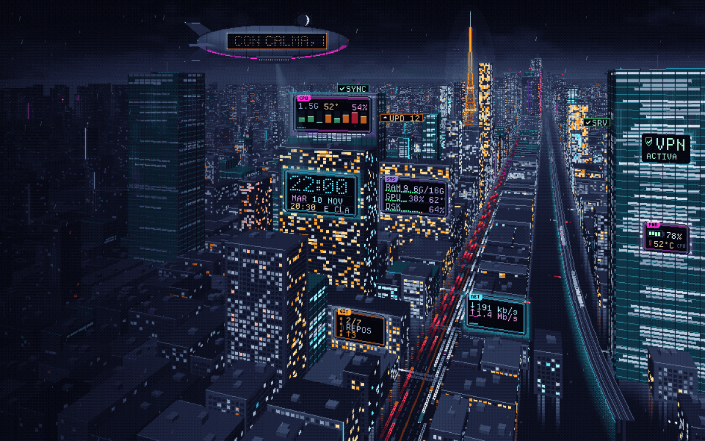

**Instalación rápida:** descarga `neongrid-1.0.0.tar.gz` desde [Releases](../../releases), descomprímelo y haz doble clic en **«Instalar NeonGrid»** (o ejecuta `./instalar.sh`). **Sin `sudo`, sin root, sin red:** todo va a tu carpeta personal y se quita con un clic.

SHA-256 del paquete 1.0.0: `d8d7297940a6537aa18eb41ad9d3f9558111623039c76644c2ddf70c6ad1d6ec`

Licencia: GPL-3.0-or-later (código y arte). Las fuentes mantienen su licencia (SIL OFL), en `paquete/neongrid/share/fonts/neongrid/`.

**Índice:** [Capturas](#capturas) · [Antes y después](#antes-y-después) · [Qué incluye](#qué-incluye) · [Requisitos](#requisitos) · [Instalar](#instalar) · [Usar y configurar](#usar-y-configurar) · [Deshacer](#deshacer) · [Rendimiento y privacidad](#rendimiento-y-privacidad) · [Cómo está hecho](#cómo-está-hecho) · [Compatibilidad](#compatibilidad-y-pruebas) · [Problemas](#problemas-frecuentes) · [Licencias](#licencias-y-créditos)

---

## Capturas

### Un día en la ciudad

La escena no es una imagen fija: cambia con la **hora real de tu ciudad**. Cuatro momentos:

| Amanecer | Día |
|---|---|
| 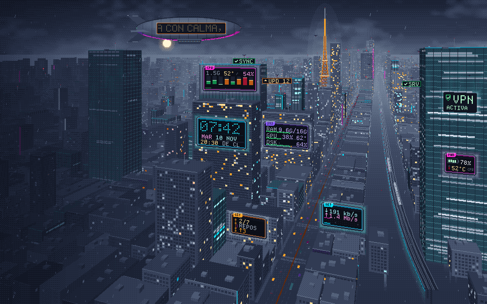 | 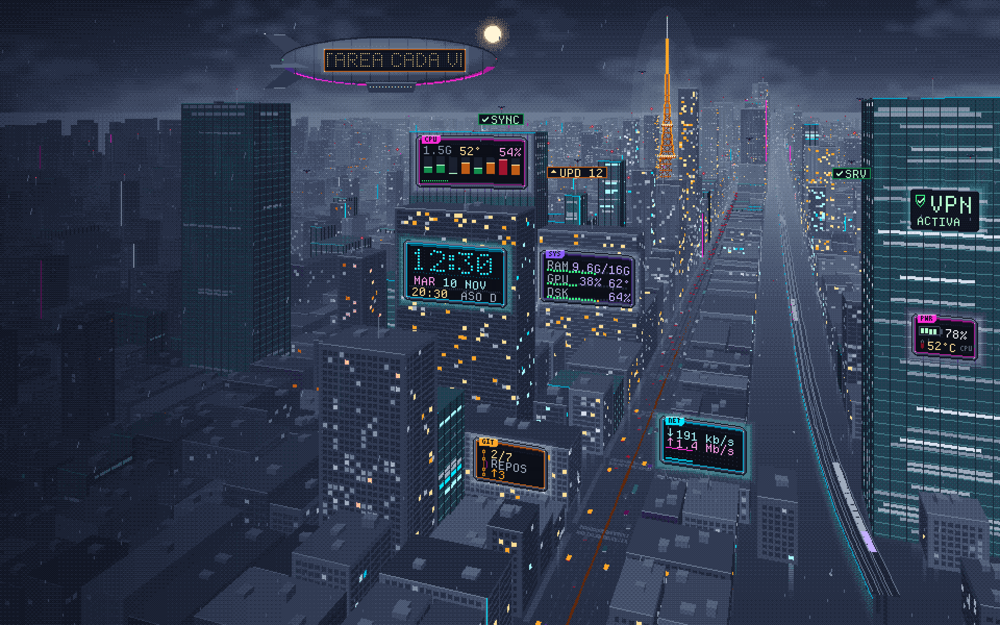 |
| **Atardecer** | **Noche** |
| 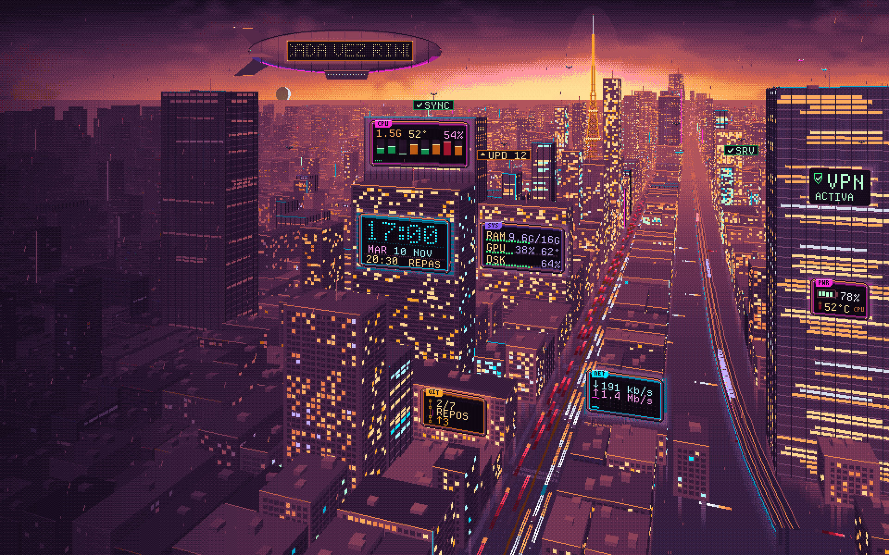 | 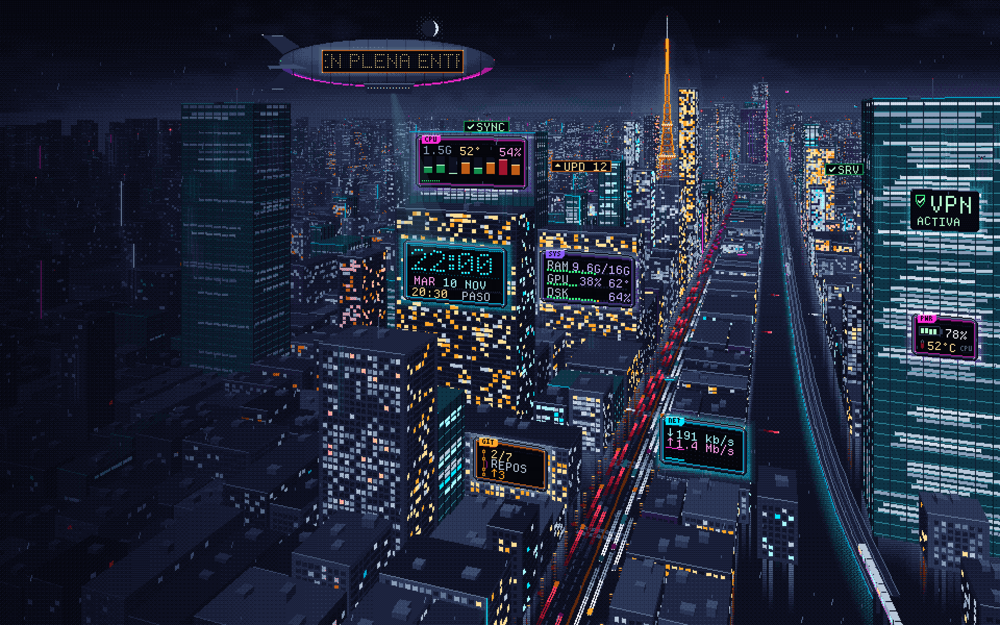 |

### El fondo sigue al sol (y a la luna)

- El sol **sale por el horizonte**, cruza el cielo y se pone; de noche **sale la luna** con su **fase real**. Los dos se esconden detrás de los edificios (los dibuja el shader solo donde hay cielo).
- El cálculo se hace **en tu equipo** con la fecha y tu zona horaria: **no usa red ni ubicación**. Si quieres afinarlo, pones tus coordenadas en «Configurar NeonGrid» (no salen de tu ordenador).
- Hay cuatro modos de cielo (noche, amanecer, día, atardecer) que se mezclan con fundidos según la altura del sol, así que los días son más cortos en invierno y más largos en verano.
- La luna sale siempre al anochecer y se pone al amanecer (su **fase** es la real; su hora de salida está simplificada).

**Un día entero en 10 segundos:**

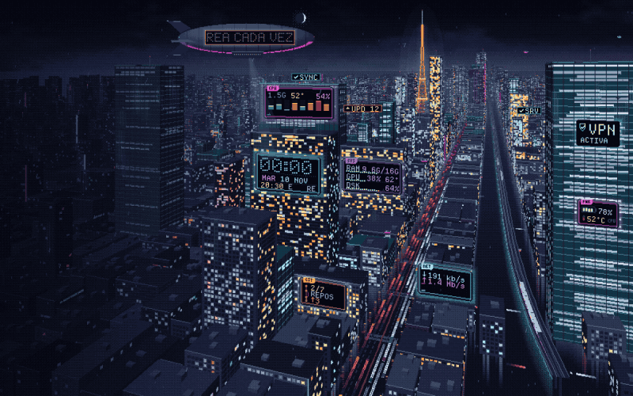

**El cielo de cerca** (el sol cruzando por encima del zepelín):


### En movimiento

Cada momento, grabado de verdad (unos 12 segundos en bucle). Se mueven la lluvia, los coches, el tren elevado, los drones, las luces de las ventanas y el zepelín, que además flota suavemente.

| Amanecer | Día |
|---|---|
| 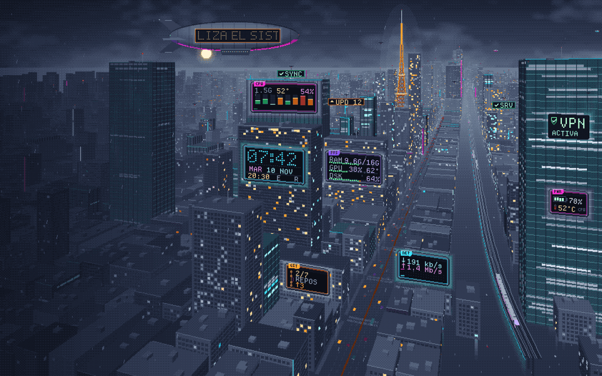 | 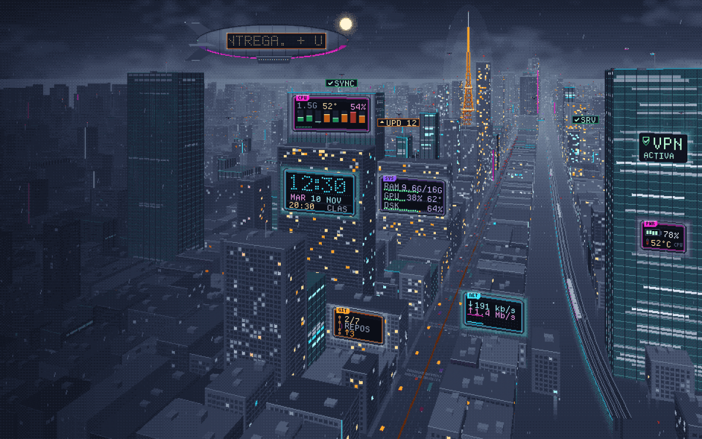 |
| **Atardecer** | **Noche** |
| 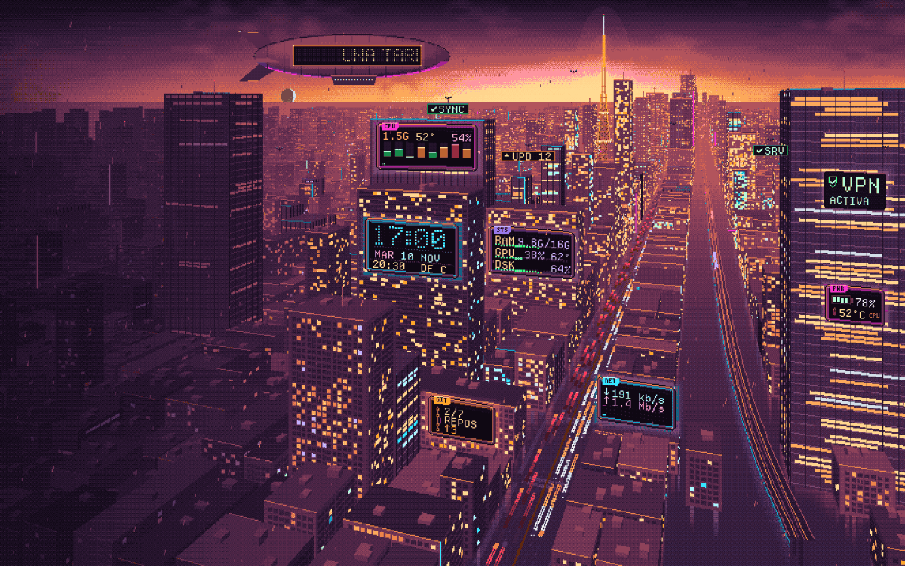 |  |

*En cada animación el fondo tiene fijada una hora; los datos de los carteles son de demostración (modo demo).*

### Los detalles

El **zepelín** flota (sube y baja un par de píxeles) y su pantalla es una **matriz LED 5×7** de verdad que pasa tus consejos:

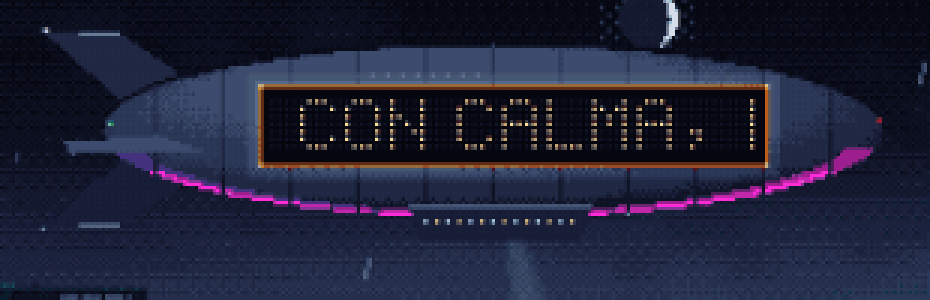

La **avenida**: coches con faros y estelas, un tren elevado, y los carteles de red y de git:

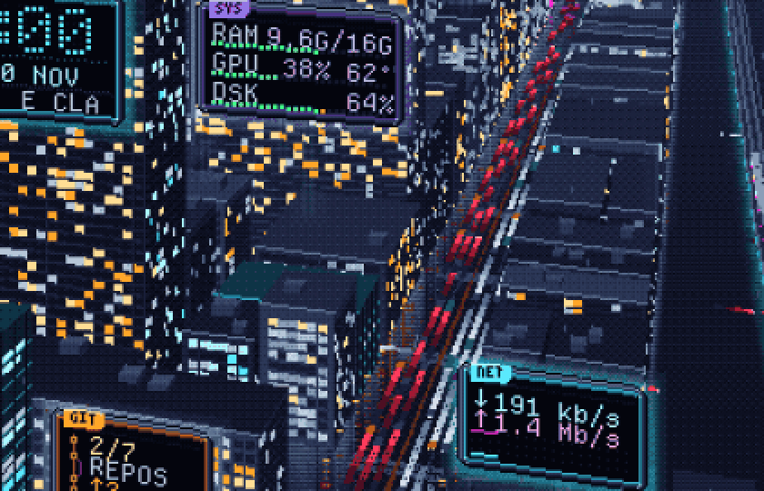

### Los carteles: datos reales

Cada cartel enseña un dato de tu equipo. **Solo lee** (`/proc`, `/sys`, `git`…), nunca escribe ni pide permisos.

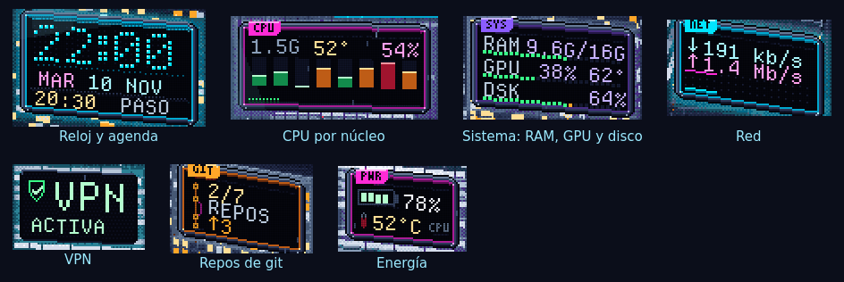

| Cartel | Qué enseña | Si no lo tienes |
|---|---|---|
| **Reloj y agenda** | hora, fecha y el próximo aviso de tu agenda (se sustituye por una alerta si la CPU pasa de 90 °C o hay un servicio caído) | — |
| **CPU** | uso por núcleo, frecuencia, temperatura y carga total | — |
| **Sistema** | RAM, GPU y disco, con barras | la GPU sale apagada |
| **Red** | bajada y subida con una gráfica | — |
| **VPN** | activa o no (y el tipo) | «sin configurar» |
| **Repos** | repos de git con cambios sin confirmar y commits sin subir | «sin repositorios» |
| **Energía** | batería, si carga, y temperatura de la CPU | sale apagado |
| **Drones** | actualizaciones pendientes (`pacman`/`apt`/`dnf`/`zypper`, **sin red**), servicios `systemd` caídos y estado de Syncthing | apagados |
| **Zepelín** | consejos que tú escribes | usa unos por defecto |
| **Lluvia** | más fuerte cuanta más carga tenga el equipo | — |

Los estados no dependen solo del color: llevan también **forma** (✔ ▲ ✖). Si falta algo, el cartel sale apagado con «sin configurar», **nunca da error**.

### Todo el tema, a juego

Ventanas, tema de Plasma, iconos, cursor, terminal y fuentes, con la misma paleta de **42 colores** (cian y magenta de acento, verde ácido para el «OK»).

| Decoración de ventanas | Tema de Plasma |
|---|---|
| 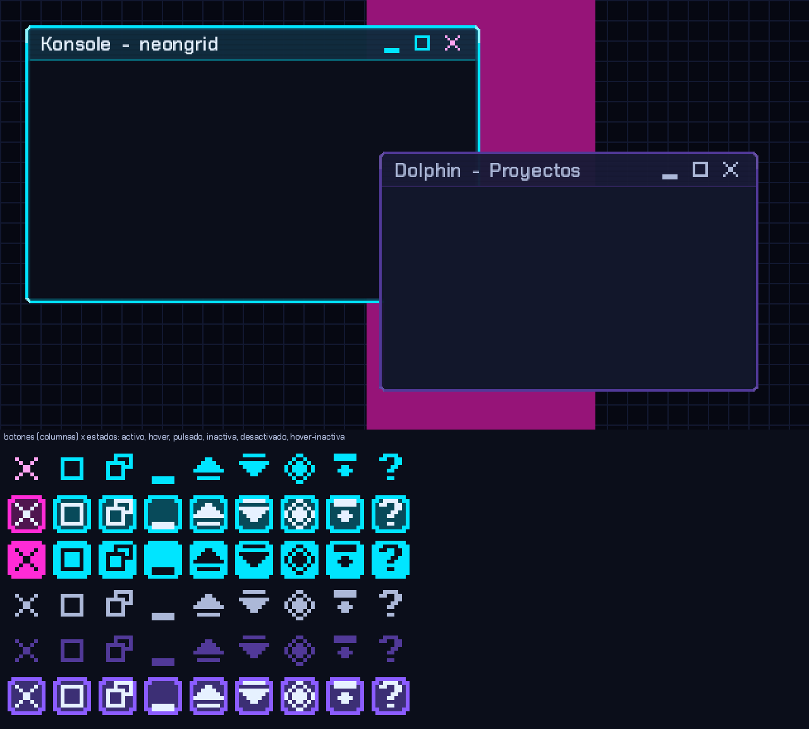 | 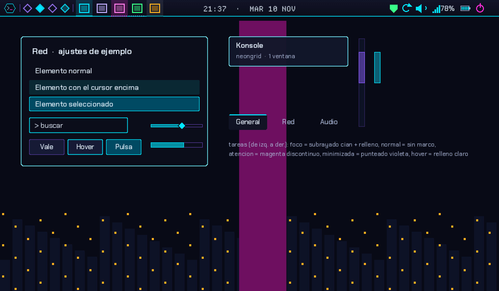 |

| Iconos | Cursor |
|---|---|
| 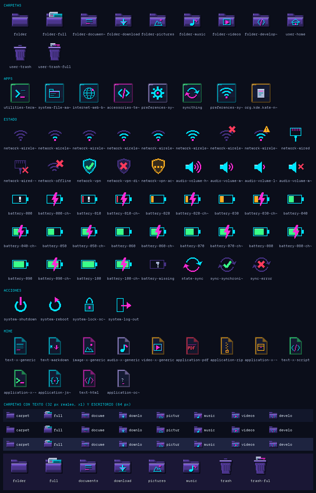 | 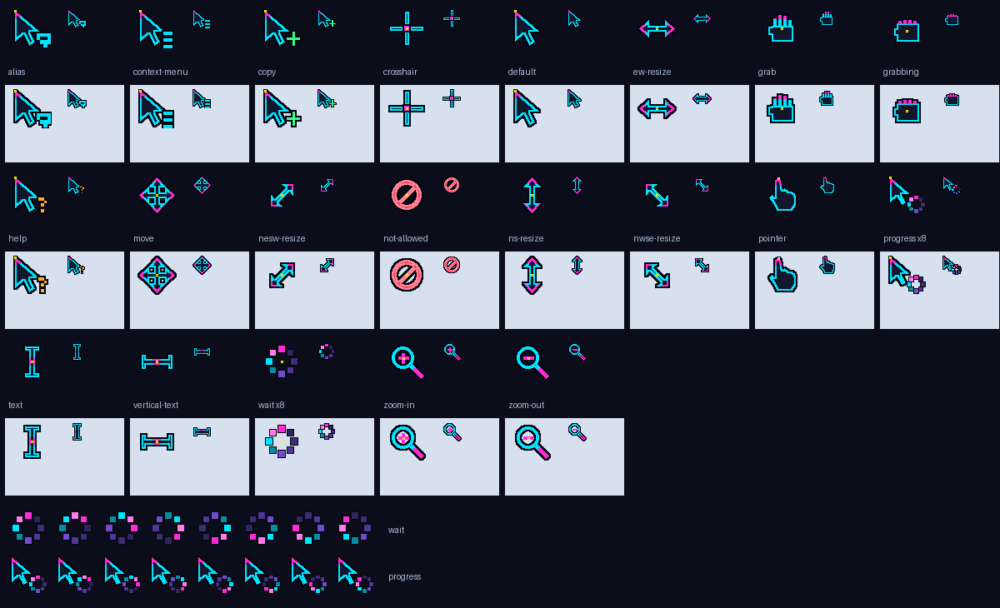 |

Y así queda el **escritorio completo** (es una **maqueta** hecha con el mismo generador, para enseñar barra, iconos, ventanas y terminal juntos):

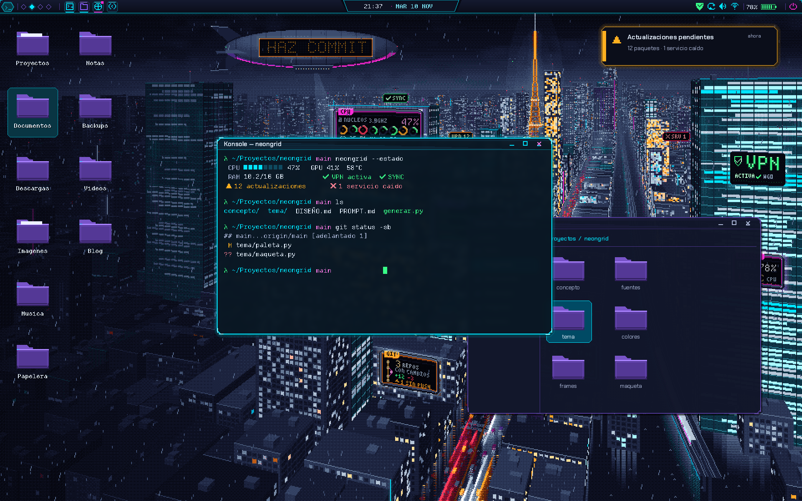

### Se adapta a tu pantalla

La escena es de 960×600 y se escala por **números enteros** para que el pixel art quede nítido. Si el entero no encaja, se ajusta para que siempre llene la pantalla (recorta un poco por la izquierda y abajo; los carteles se quedan a la vista).

| Resolución | Cómo queda |
|---|---|
| 1024×768 · 1280×720 · 1366×768 · 1280×1024 | Escala ajustada (1,3×–1,7×): llena la pantalla |
| 1440×900 · 1600×900 · 1920×1080 · 1920×1200 | 2× entero: pixel perfecto |
| 2560×1440 · 2560×1600 · 3840×2160 | 3×–4× entero: pixel perfecto |
| Ultrapanorámicas (2560×1080, 3440×1440) | La ciudad llena el alto y los lados se rellenan con la ciudad desenfocada. Es el caso más flojo: funciona, pero no luce igual |

| 1366×768 (portátil sencillo) | 2560×1440 |
|---|---|
| 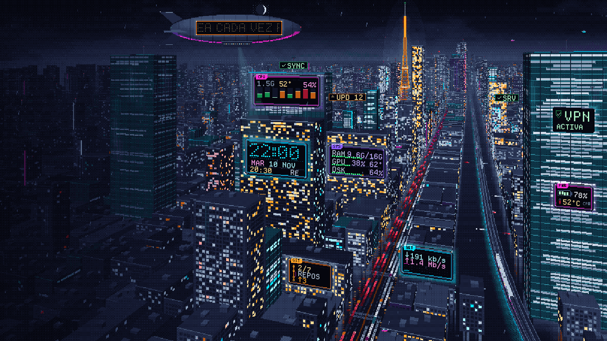 | 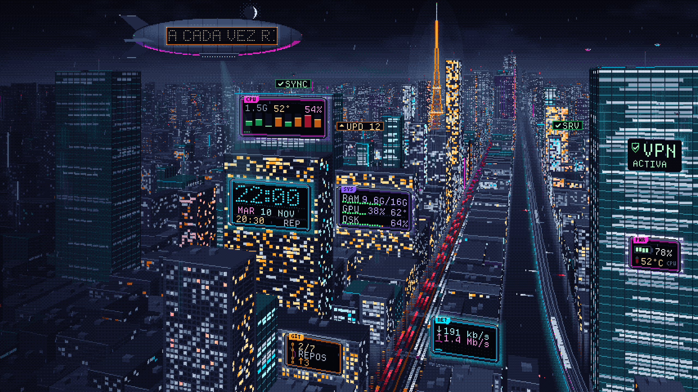 |

---

## Antes y después

Esto empezó con una imagen de referencia: una ciudad japonesa de noche, con lluvia y mucho neón. Quería un escritorio así, pero en pixel art y con **datos de verdad** en los carteles.

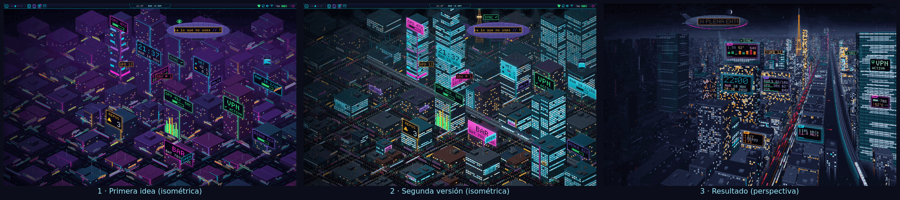

1. **Primera idea: ciudad isométrica.** Bonita, pero los carteles quedaban diminutos y todos los bloques se parecían.
2. **Segunda versión: más detalle, igual de isométrica.** Mejor, pero seguía sin la profundidad de la referencia.
3. **La buena: vista en perspectiva** con puntos de fuga, una avenida con tren elevado, niebla por capas y los carteles como lo más luminoso de la escena. Ahí ya se leía todo y se sentía ciudad.

<details>
<summary>Las dos primeras ideas, a tamaño completo</summary>

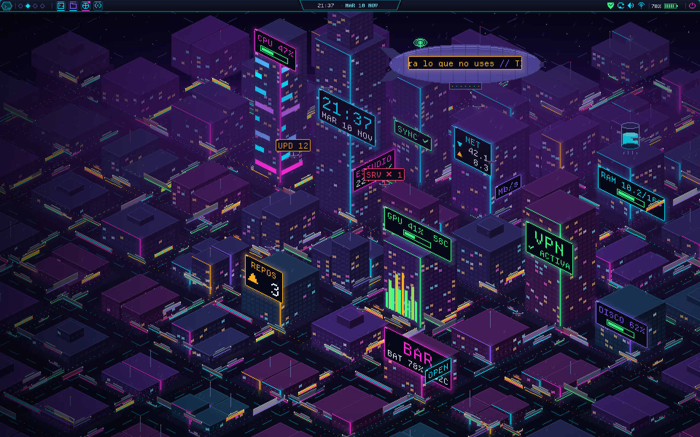
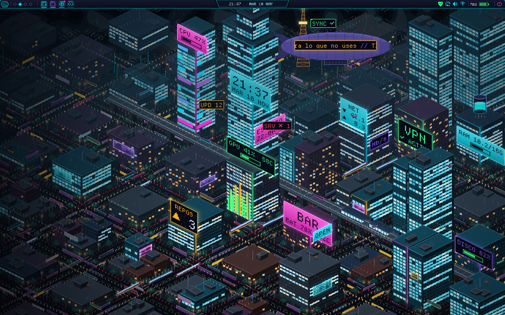

</details>

---

## Qué incluye

| Pieza | Detalle |
|---|---|
| **Fondo animado** | Plugin de Plasma `org.neongrid.wallpaper`: escena con sol, luna, lluvia, tren, coches, drones y zepelín. También se pone en la **pantalla de bloqueo** |
| **Carteles con datos** | Scripts de Python (solo librería estándar) que leen el equipo y entregan JSON |
| **Colores** | Esquema de colores de Plasma `NeonGrid` |
| **Ventanas** | Decoración Aurorae con bordes biselados y botones pixel |
| **Tema de Plasma** | Barra, menús, controles y paneles |
| **Iconos y cursor** | Tema de iconos y cursores pixel |
| **Terminal** | Esquema y perfil de **Konsole** (y de **Alacritty** con `--alacritty`) |
| **Fuentes** | Chakra Petch (interfaz) y Departure Mono (carteles y terminal) |
| **Barra superior** | 32 px, ancho completo: menú, escritorios, tareas, reloj, bandeja y apagado |
| **«Configurar NeonGrid»** | Menú con ventanas de KDE para repos de git, agenda, consejos, ciudad y modo calma |
| **«Quitar» y «Desinstalar»** | Vuelven a como estaba, o lo borran todo |
| **Idiomas** | Español e inglés (automático según tu sistema) |

---

## Requisitos

| Qué | Detalle |
|---|---|
| **KDE Plasma 6** | Probado en CachyOS con Plasma 6.8 (Wayland). **Plasma 5 no vale**: el instalador lo detecta y no toca nada. |
| `python3`, `kconfig` (`kwriteconfig6`), `fontconfig` | Casi seguro que ya los tienes. Si falta algo, el instalador te dice **qué comando ejecutar tú** para tu distribución (nunca lo ejecuta él). |
| `kdialog` (opcional) | Para las ventanas del instalador y de «Configurar NeonGrid». Viene con KDE. |
| Una GPU cualquiera | La animación es ligera. Sin aceleración gráfica se muestra la imagen estática. |

Nombres de paquete habituales: Arch/CachyOS `python kconfig fontconfig` · Debian/Ubuntu `python3 kde-cli-tools libkf6config-bin fontconfig` · Fedora `python3 kf6-kconfig fontconfig`.

---

## Instalar

**Lo más fácil (3 pasos):**

1. **Descarga** `neongrid-1.0.0.tar.gz` desde [Releases](../../releases) y descomprímelo (clic derecho → *Extraer aquí*).
2. **Doble clic en «Instalar NeonGrid».** Te pregunta qué quieres instalar y **guarda una copia de tus ajustes** antes de cambiar nada.
3. **Listo.** El escritorio se reinicia solo unos segundos y ya tienes la ciudad.

> ¿No te deja ejecutar el doble clic? Abre una terminal en la carpeta y escribe `./instalar.sh`.

**Desde la terminal:**

```bash
tar xzf neongrid-1.0.0.tar.gz && cd neongrid
./instalar.sh                    # instala y aplica todo
./instalar.sh --sin-fondo        # sin el fondo animado
./instalar.sh --sin-panel        # no toca tu barra
./instalar.sh --alacritty        # configura también Alacritty
./instalar.sh --sin-aplicar      # solo copia ficheros, no cambia ningún ajuste
```

**Solo toca tu usuario, nunca usa `sudo`.** Esto es lo que hace:

| Dónde | Qué |
|---|---|
| `~/.local/share/` | el tema (colores, ventanas, Plasma, iconos, fuentes), el fondo y los scripts en `neongrid/` |
| `~/.config/` | tus ajustes: esquema de colores, iconos, cursor, decoración de ventanas, tema de Plasma, perfil de Konsole, fondo de la pantalla de bloqueo y la barra superior |
| `~/.config/neongrid/` | tu configuración (`config.json`, `agenda.txt`, `consejos.txt`, `repos.txt`) |
| `~/.local/share/applications/` | tres entradas de menú: *Configurar*, *Quitar* y *Desinstalar NeonGrid* |
| `~/.local/share/neongrid/copia-previa/` | **la copia de tus ajustes de antes**, para poder volver |

Si tenías widgets de otro tema (por ejemplo, el HUD de [PixelZen](https://github.com/mosqui1988/pixelzen)), los **desactiva** para que no se mezclen; no los desinstala, y *Quitar NeonGrid* los devuelve.

---

## Usar y configurar

Tras instalar, abre el menú de aplicaciones y busca **Configurar NeonGrid**. Con ventanas de KDE puedes:

- **Añadir un repo de git** eligiendo la carpeta con el selector (sin escribir rutas), quitarlos o volver a la búsqueda automática.
- **Editar tu agenda** (avisos del día con la hora) y los **consejos del zepelín**.
- **Poner tu ciudad** para afinar el amanecer y el atardecer.
- Activar el **modo calma** (menos movimiento: el zepelín flota menos, el texto va más lento, sin parpadeos).

Si prefieres los ficheros, todo vive en `~/.config/neongrid/`. La **guía completa** (formato de cada fichero, qué hace cada ajuste, problemas típicos) está en [`paquete/neongrid/GUIA.md`](paquete/neongrid/GUIA.md) y se instala también en `~/.local/share/neongrid/GUIA.md`.

Para capturas sin datos reales, crea un fichero vacío `~/.config/neongrid/demo` (modo demo) y bórralo para volver a los datos de verdad.

---

## Deshacer

| Quiero… | Cómo |
|---|---|
| **Volver a como estaba** | Menú de aplicaciones → **Quitar NeonGrid** (o `~/.local/share/neongrid/revertir.sh`). Restaura la copia que se guardó al instalar. NeonGrid sigue instalado por si quieres volver a ponerlo. |
| **Borrarlo del todo** | Menú de aplicaciones → **Desinstalar NeonGrid**. Te pregunta si borra también tu agenda y ajustes. |

---

## Rendimiento y privacidad

- **Ligero:** la escena se anima a **8 imágenes por segundo** (6 en calidad media) y se calcula a 960×600 antes de escalar. **Se pausa sola** con la pantalla bloqueada, con la batería baja o si el fondo no se ve, y **baja la calidad** si tu equipo va justo. Sin aceleración gráfica muestra una imagen estática.
- **Privado:** no usa internet, no pide tu ubicación y no envía nada. La hora del cielo sale de tu zona horaria. Los scripts de datos **solo leen** `/proc`, `/sys` y herramientas estándar; la única conexión posible es el puerto local de Syncthing (`127.0.0.1:8384`) con un tope de 300 ms, y solo si lo tienes.
- **Sin permisos especiales:** sin `sudo`, sin root, sin servicios ni demonios.

---

## Cómo está hecho

- **Python + Pillow dibujan la ciudad por código**, píxel a píxel: edificios con rampas de 4 tonos, ventanas, calles mojadas con reflejos, niebla por capas, carteles… con una paleta global de **42 colores**.
- **Un shader GLSL** hace todo lo que se mueve, a la resolución lógica: luces de ventanas, coches, tren, drones, lluvia, balizas, y el **sol y la luna** (que se ocultan tras los edificios gracias a un mapa de profundidad).
- **QML** pinta lo vivo encima: el texto de los carteles, la pantalla LED del zepelín (matriz 5×7) y el propio zepelín, que flota.
- **Scripts de Python (solo librería estándar)** leen los datos del equipo y los pasan como JSON.
- Cada pieza se probó en un **KWin virtual aislado**, con su propia carpeta de usuario, sin tocar el escritorio real durante el desarrollo.
- El diseño, el código y las pruebas los hice **con Claude Code**, mirando capturas en cada paso. El proceso completo, con los errores, está en el [artículo del blog](https://ralcaniz.dev/posts/neongrid-ciudad-cyberpunk-kde/).

Para entrar a fondo: [`docs/DISENO.md`](docs/DISENO.md) (decisiones de diseño) y [`docs/ARQUITECTURA.md`](docs/ARQUITECTURA.md) (cómo encajan las piezas).

### Reconstruir el fondo (solo si quieres tocar el código)

El paquete **ya trae las capas hechas**; esto es solo para modificarlas. Necesitas Python con **Pillow**, `qsb` (Qt Shader Tools) y las fuentes *Departure Mono*, *Micro 5* y *DotGothic16* (todas OFL; descárgalas de Google Fonts o de sus repos) en una carpeta cuya ruta pones en `NG_FUENTES`:

```bash
python3 -m venv .venv && .venv/bin/pip install pillow
NG_FUENTES=~/mis-fuentes .venv/bin/python tema/fondo/construir-capas.py   # ~20 s
tema/empaquetar.sh 1.0.0                                                    # genera dist/neongrid-1.0.0.tar.gz
tema/capturas/hacer-capturas.sh capturas/                                   # capturas y GIF (usa un KWin virtual)
```

```
paquete/neongrid/   el tema listo para instalar (lo que va en la release)
tema/               generadores: colores, ventanas, Plasma, iconos, cursor, fondo, capturas
concepto/           los generadores de la escena de la ciudad
docs/               diseño y arquitectura
capturas/           las imágenes y GIF de este README
```

---

## Compatibilidad y pruebas

| Sistema | Estado |
|---|---|
| **CachyOS / Arch**, KDE Plasma 6.8, Wayland | ✅ Probado en un equipo real: instalar, configurar y quitar. *Desinstalar* solo en las pruebas automáticas |
| Fedora KDE, openSUSE Tumbleweed, Debian 13, Kubuntu | ⚠️ Sin probar. El instalador ya sabe qué paquetes pedir en cada una |
| KDE Plasma 5 | ❌ No compatible (el instalador lo detecta y no toca nada) |
| GNOME y otros escritorios | ❌ No incluido |

El instalador tiene **16 pruebas automáticas** (en una carpeta de usuario falsa) que se pasan antes de generar cada paquete. Si lo pruebas en otra distribución, **cuéntame cómo te fue** en un [issue](../../issues), con tu distro y la versión de Plasma (`plasmashell --version`).

---

## Problemas frecuentes

| Problema | Solución |
|---|---|
| «Faltan estas herramientas» | El instalador te da el comando exacto para tu distro. Ejecútalo tú y vuelve a instalar. |
| El doble clic no hace nada | Abre una terminal en la carpeta y ejecuta `./instalar.sh`. |
| El fondo va a tirones o gasta batería | Activa el **modo calma** en «Configurar NeonGrid». La animación se pausa sola con la pantalla bloqueada o la batería baja. |
| Me quedó el escritorio a medias | Cierra sesión y vuelve a entrar, o usa **Quitar NeonGrid**. |
| El cartel de repos dice «sin repositorios» | «Configurar NeonGrid» → *Añadir un repositorio*. |
| El amanecer sale unos minutos desviado | «Configurar NeonGrid» → *Mi ciudad*. |
| Mi pantalla es ultrapanorámica y los lados se ven raros | Es el caso menos pulido (relleno desenfocado a los lados). Funciona, pero no luce igual. |

---

## Licencias y créditos

- Código y arte: **GPL-3.0-or-later** (ver [`LICENSE`](LICENSE)).
- Fuentes: **Chakra Petch** y **Departure Mono**, ambas bajo SIL OFL 1.1; sus licencias van en `paquete/neongrid/share/fonts/neongrid/`.
- Hermano de [PixelZen](https://github.com/mosqui1988/pixelzen), el tema de Japón antiguo.

---

## English (short)

**NeonGrid** is an animated pixel-art cyberpunk city wallpaper and theme for **KDE Plasma 6**. Every neon sign shows real data from your machine (CPU, RAM, network, VPN, git repos, battery…), with a real-time sun and moon (real phase), rain, trains, cars and a floating blimp. It includes window decorations, Plasma theme, icons, cursor, Konsole profile and a top bar.

**Install:** download the `.tar.gz` from [Releases](../../releases), extract it and double-click *Instalar NeonGrid* (or run `./instalar.sh`). **No `sudo`, no root, no network:** everything goes into your home folder, a backup of your settings is made first, and *Quitar NeonGrid* (Remove) restores it. **Configure:** application menu → *Configurar NeonGrid* (git repos, agenda, tips, city, calm mode). Tested on CachyOS (Plasma 6.8, Wayland); other distributions are untested, reports welcome. GPL-3.0-or-later.
